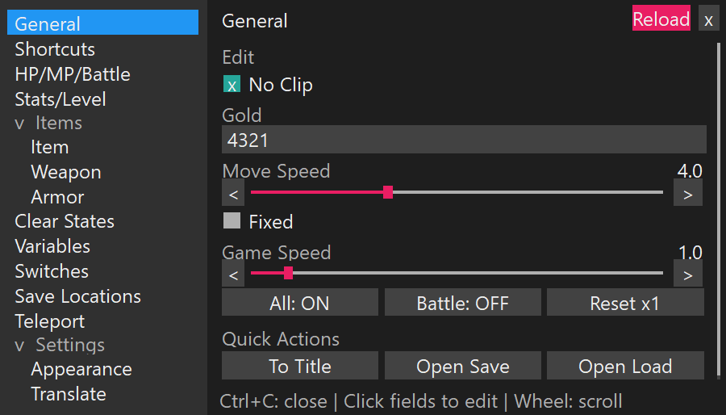

# VX Ace Cheat Menu Improved

A mouse-driven cheat menu for **RPG Maker VX Ace games on Windows**. Edit your
party, inventory, and game settings without opening the RPG Maker editor.
RPG Maker XP, original VX, MV, and MZ games are not supported by this package.

*Menu preview, rendered outside the game.*

## Install

1. [Download the ZIP](https://github.com/MaybeYouShould-GetTheHeckouttaHere/VXCheatMenu/archive/refs/heads/main.zip) and extract it.
2. Close your game.
3. Copy the **`cheat` folder**, **`Install.ps1`**, **`Install.cmd`**, and
   **`Uninstall.cmd`** into the game folder, beside **`Game.exe`** and **`Game.ini`**.
4. Double-click **`Install.cmd`**, then launch the game normally.

No extra software is needed. The installer creates backups; keep
`Game.ini.vxcheat-backup` and the generated backup files in `cheat/`.
For updates, merge the new files and run the installer again without deleting those
backups. [Backup and update details](docs/backups-and-settings.md).

## Open and use

Press **Ctrl+C** on a map or in battle. Click the tabs and fields to make changes;
press **Enter** or click away to apply an edit. **Esc** cancels an edit or closes
the menu.

For sharper text, use windowed or borderless mode. Under **Settings > Appearance**,
change **UI Size** and **Text Size** separately. Drag the header to move the card,
or hold **Ctrl** and scroll over it to resize.

## Main features

- Gold, items, weapons, and armor
- Actor levels, stats, health, and god mode
- No clip, movement speed, and game speed
- Encounter controls and battle actions
- Switch and variable editing
- Teleporting and saved location bookmarks

[All keyboard shortcuts](docs/shortcuts.md).

## Uninstall

Close the game and double-click **`Uninstall.cmd`**. This restores the installation
backups. It does not undo changes you saved to your game progress.

## Having trouble?

- **Menu missing?** Focus the game and press **Ctrl+C**. Try windowed mode, or
  **Ctrl+Shift+F10** to switch renderers while the menu is open.
- **Text too small?** Open **Settings > Appearance** and increase **Text Size**.
- **Installer or panel error?** Check [troubleshooting](docs/compatibility.md#troubleshooting).
  Keep the backups and include any error text when
  [reporting an issue](https://github.com/MaybeYouShould-GetTheHeckouttaHere/VXCheatMenu/issues).

More detail: [compatibility](docs/compatibility.md),
[backups and saved settings](docs/backups-and-settings.md),
[development](docs/development.md).
